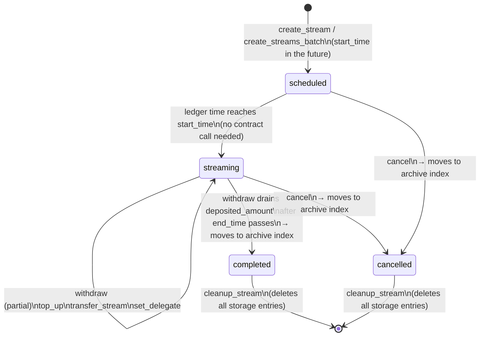

# Stream Lifecycle and Statuses

This page explains every status a FlowStar stream can be in, how the UI derives those statuses, and which contract calls move a stream from one state to another.

---

## Status overview

A stream has two layers of state: the **UI status** shown to users, and the **on-chain state** that the contract stores.

### UI statuses

Computed by `getStreamStatus` in `lib/stream-utils.ts` from the stream struct returned by `get_stream`.

| Status | Meaning |
|---|---|
| `scheduled` | Stream exists but `start_time` is still in the future; no funds have unlocked yet |
| `streaming` | Current time is between `start_time` and `end_time`; funds are unlocking linearly |
| `completed` | `end_time` has passed and all funds have been fully withdrawn (or the stream was fully drained) |
| `cancelled` | Sender called `cancel`; remaining funds were returned to the sender |

The `cancelled` check takes priority: a stream with `cancelled = true` always shows as `cancelled` regardless of its time window.

### On-chain states

| State | What it means in storage |
|---|---|
| **Active** | `Stream(id)` entry exists in `SentBy` / `ReceivedBy` persistent index lists |
| **Archived** | Stream moved to `ArchiveSentBy` / `ArchiveReceivedBy` after cancellation or full drain |
| **Cleaned up** | All storage entries for the stream have been deleted by `cleanup_stream` |

---

## State diagram



**Reading the diagram:**
- Arrows labelled with a contract function name mean that call triggers the transition.
- The `scheduled → streaming` transition is time-based: the contract reads `env.ledger().timestamp()` on every query or write; no explicit call is needed to move from scheduled to streaming.
- Archiving (active → archived) happens automatically inside `cancel` and inside `withdraw` when the recipient drains the last token after `end_time`.

---

## Transitions in detail

### `create_stream` / `create_streams_batch`

Creates a new `Stream` struct and writes it to persistent storage under `Stream(id)`. The ID is added to `SentBy(sender)` and `ReceivedBy(recipient)`.

- If `start_time > now` → UI status is `scheduled`.
- If `start_time <= now` → UI status is `streaming` immediately.

### `withdraw`

Moves tokens to the recipient. The stream stays active unless the withdrawal fully drains `deposited_amount` and `end_time` has passed, in which case the stream is moved to the archive index automatically.

### `cancel`

Sets `cancelled = true` on the stream struct and returns all unwithdrawn funds to the sender. The stream ID is removed from the active index (`SentBy` / `ReceivedBy`) and added to the archive index (`ArchiveSentBy` / `ArchiveReceivedBy`). UI status becomes `cancelled`.

### `cleanup_stream`

Removes all on-chain storage for a stream that is already archived (cancelled or fully drained). Deletes `Stream(id)`, `StreamMetadata(id)` (if present), `Delegate(id)` (if present), and removes the ID from both archive index lists.

Can only be called once a stream is in the archived state; calling it on an active or incomplete stream returns `StreamNotEligibleForCleanup` (20).

---

## How `getStreamStatus` works

`lib/stream-utils.ts` applies the following checks in order:

1. `stream.cancelled === true` → `"cancelled"`
2. `now < stream.start_time` → `"scheduled"`
3. `now >= stream.start_time && now < stream.end_time` → `"streaming"`
4. `now >= stream.end_time` → `"completed"`

`now` is the client's current Unix timestamp in seconds. For display purposes this matches closely enough with the ledger timestamp; the contract itself always uses `env.ledger().timestamp()` for all unlock math.

---

## Corresponding types

Defined in `types/stream.ts`:

```typescript
export type StreamStatus = "scheduled" | "streaming" | "completed" | "cancelled";
```

The raw `Stream` struct from the contract (returned by `get_stream`) uses `cancelled: boolean` for the on-chain flag. All other status values are derived by the frontend.

---

## See Also

- [API Reference](./api-reference.md) — full function signatures and error codes
- [Integration Guide](./integration-guide.md) — JavaScript examples for each contract call
